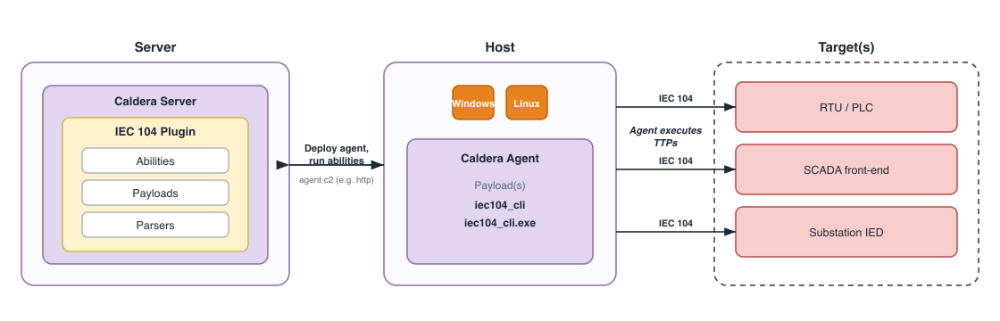

# IEC 104
IEC 60870-5-104 (IEC 104) protocol abilities for Caldera for OT.

v1.0.0 released 3 Nov 2026

## Overview
The IEC 104 plugin provides __6__ unique abilities specific to the IEC 104 protocol. This is accomplished not through exploitation, but rather by leveraging native functionality within the protocol. The specification for the IEC 104 protocol is available for purchase from [the IEC](https://webstore.iec.ch/).

The following table outlines MITRE ATT&CK for ICS coverage provided by the IEC 104 plugin.

|Collection|Impair-Process-Control|
|:--|:--|
|Point & Tag Identification|Modify Parameter|
| |Unauthorized Command Message|

### Ability Overview Tables
The following table(s) list each plugin ability by their corresponding tactic.

#### Collection Abilities
|Name|Tactic|Technique|Technique Id|
|:--|:--|:--|:--|
|[IEC 104 - Counter Interrogation](#iec-104---counter-interrogation)|collection|Point & Tag Identification|T0861|
|[IEC 104 - Station Interrogation](#iec-104---station-interrogation)|collection|Point & Tag Identification|T0861|

#### Impair-Process-Control Abilities
|Name|Tactic|Technique|Technique Id|
|:--|:--|:--|:--|
|[IEC 104 - Clock Synchronization](#iec-104---clock-synchronization)|impair-process-control|Unauthorized Command Message|T0855|
|[IEC 104 - Double Command](#iec-104---double-command)|impair-process-control|Unauthorized Command Message|T0855|
|[IEC 104 - Set Point Command](#iec-104---set-point-command)|impair-process-control|Modify Parameter|T0836|
|[IEC 104 - Single Command](#iec-104---single-command)|impair-process-control|Unauthorized Command Message|T0855|


## Architecture
This section describes the main components of the plugin and how they interface.

### Block Diagram


The IEC 104 plugin exposes several new protocol specific abilities to your Caldera instance. The abilities are executed from a host running a Caldera agent via the corresponding payload. Abilities must target devices that support the IEC 104 protocol to achieve described effects. By default the plugin will use __2404__ for all communication.

### Payloads
The IEC 104 plugin includes 1 distinct payload(s) that implement the abilities:

- `iec104_cli`: &emsp; Generic IEC 60870-5-104 client; one subcommand per ability, parameterized by facts. Distributed from the iec104-payloads repository releases (no macOS build; the underlying c104 library has no maintained macOS target).

  - Compatible with Linux, Windows
  - Compiled with PyInstaller (Python 3.10)

### Libraries
The following libraries were used to build the IEC 104 payloads:  

|Library|Version|License|
|:--|:--|:--|
|[c104](https://pypi.org/project/c104/)|[2.2.1](https://pypi.org/project/c104/2.2.1/)|[GPL-3.0](https://github.com/Fraunhofer-FIT-DIEN/iec104-python/blob/main/LICENSE)|

## Usage
This section describes how to initially deploy and execute the abilities present within the IEC 104 plugin.

### Deployment
1. Identify the target system you would like to communicate with via the IEC 104 protocol.
2. Identify a viable host for the Caldera agent that will be sending IEC 104 messages to the target system.
3. Deploy the Caldera agent to the viable host.
4. Run a combination of the IEC 104 plugin abilities to achieve the desired effect.  

*Reference the Caldera training plugin for a step-by-step tutorial on how to deploy an agent and run abilities via an operation.*

### Abilities
#### IEC 104 - Counter Interrogation
IEC 60870-5-104 general counter interrogation (C_CI_NA_1). Requests the
integrated totals (counters) held by the outstation - e.g. accumulated energy
or run-time values - enumerating counter points and their frozen values.

__Ability Command:__
<details open>
<summary>Windows (psh)</summary>
<br>

```caldera
.\iec104_cli.exe #{iec104.server.ip} --port #{iec104.server.port} --ca #{iec104.common_address} counter-interrogate
```  

</details>
<details>
<summary>Linux (sh)</summary>
<br>

```caldera
./iec104_cli #{iec104.server.ip} --port #{iec104.server.port} --ca #{iec104.common_address} counter-interrogate
```  

</details>
<br>

__Facts:__  
| Name | Description | Type |
|:-----|:------------|:----:|
| `iec104.server.ip` | Target IEC 104 outstation IP address | string |
| `iec104.server.port` | Target IEC 104 TCP port (default 2404) | int |
| `iec104.common_address` | ASDU common address (station address) of the outstation | int |

#### IEC 104 - Station Interrogation
IEC 60870-5-104 general (station) interrogation (C_IC_NA_1). Requests the
current value of every information object the outstation exposes, enumerating
its points and their states.

__Ability Command:__
<details open>
<summary>Windows (psh)</summary>
<br>

```caldera
.\iec104_cli.exe #{iec104.server.ip} --port #{iec104.server.port} --ca #{iec104.common_address} interrogate
```  

</details>
<details>
<summary>Linux (sh)</summary>
<br>

```caldera
./iec104_cli #{iec104.server.ip} --port #{iec104.server.port} --ca #{iec104.common_address} interrogate
```  

</details>
<br>

__Facts:__  
| Name | Description | Type |
|:-----|:------------|:----:|
| `iec104.server.ip` | Target IEC 104 outstation IP address | string |
| `iec104.server.port` | Target IEC 104 TCP port (default 2404) | int |
| `iec104.common_address` | ASDU common address (station address) of the outstation | int |

#### IEC 104 - Clock Synchronization
Send an IEC 60870-5-104 clock synchronization command (C_CS_NA_1), setting the
outstation's clock. Manipulating an outstation's time can misalign event time
stamps and sequence-of-events records, undermining the operator's view of the
process.

__Ability Command:__
<details open>
<summary>Windows (psh)</summary>
<br>

```caldera
.\iec104_cli.exe #{iec104.server.ip} --port #{iec104.server.port} --ca #{iec104.common_address} clock-sync
```  

</details>
<details>
<summary>Linux (sh)</summary>
<br>

```caldera
./iec104_cli #{iec104.server.ip} --port #{iec104.server.port} --ca #{iec104.common_address} clock-sync
```  

</details>
<br>

__Facts:__  
| Name | Description | Type |
|:-----|:------------|:----:|
| `iec104.server.ip` | Target IEC 104 outstation IP address | string |
| `iec104.server.port` | Target IEC 104 TCP port (default 2404) | int |
| `iec104.common_address` | ASDU common address (station address) of the outstation | int |

#### IEC 104 - Double Command
Send an IEC 60870-5-104 double command (C_DC_NA_1) to a control point,
driving it ON or OFF. Double commands carry a two-bit state and are commonly
used for breaker/switch control; an unauthorized double command can trip or
close such devices on the outstation.

__Ability Command:__
<details open>
<summary>Windows (psh)</summary>
<br>

```caldera
.\iec104_cli.exe #{iec104.server.ip} --port #{iec104.server.port} --ca #{iec104.common_address} double-command #{iec104.command.ioa} #{iec104.command.value}
```  

</details>
<details>
<summary>Linux (sh)</summary>
<br>

```caldera
./iec104_cli #{iec104.server.ip} --port #{iec104.server.port} --ca #{iec104.common_address} double-command #{iec104.command.ioa} #{iec104.command.value}
```  

</details>
<br>

__Facts:__  
| Name | Description | Type |
|:-----|:------------|:----:|
| `iec104.server.ip` | Target IEC 104 outstation IP address | string |
| `iec104.server.port` | Target IEC 104 TCP port (default 2404) | int |
| `iec104.common_address` | ASDU common address (station address) of the outstation | int |
| `iec104.command.ioa` | Information Object Address (IOA) of the target control point | int |
| `iec104.command.value` | Command value to send (e.g. ON or OFF) | string |

#### IEC 104 - Set Point Command
Send an IEC 60870-5-104 set-point command (C_SE_NC_1, short floating point) to
an analog control point. Altering a set-point changes a process target value
(flow, pressure, speed, level), modifying how the process is controlled.

__Ability Command:__
<details open>
<summary>Windows (psh)</summary>
<br>

```caldera
.\iec104_cli.exe #{iec104.server.ip} --port #{iec104.server.port} --ca #{iec104.common_address} setpoint #{iec104.setpoint.ioa} #{iec104.setpoint.value}
```  

</details>
<details>
<summary>Linux (sh)</summary>
<br>

```caldera
./iec104_cli #{iec104.server.ip} --port #{iec104.server.port} --ca #{iec104.common_address} setpoint #{iec104.setpoint.ioa} #{iec104.setpoint.value}
```  

</details>
<br>

__Facts:__  
| Name | Description | Type |
|:-----|:------------|:----:|
| `iec104.server.ip` | Target IEC 104 outstation IP address | string |
| `iec104.server.port` | Target IEC 104 TCP port (default 2404) | int |
| `iec104.common_address` | ASDU common address (station address) of the outstation | int |
| `iec104.setpoint.ioa` | Information Object Address (IOA) of the target set-point | int |
| `iec104.setpoint.value` | Set-point value to write | float |

#### IEC 104 - Single Command
Send an IEC 60870-5-104 single command (C_SC_NA_1) to a control point,
driving it ON or OFF. An unauthorized single command can operate breakers,
pumps, valves, or other single-point actuators on the outstation. Where the
outstation requires select-before-operate, use the payload's select-before-operate
option.

__Ability Command:__
<details open>
<summary>Windows (psh)</summary>
<br>

```caldera
.\iec104_cli.exe #{iec104.server.ip} --port #{iec104.server.port} --ca #{iec104.common_address} single-command #{iec104.command.ioa} #{iec104.command.value}
```  

</details>
<details>
<summary>Linux (sh)</summary>
<br>

```caldera
./iec104_cli #{iec104.server.ip} --port #{iec104.server.port} --ca #{iec104.common_address} single-command #{iec104.command.ioa} #{iec104.command.value}
```  

</details>
<br>

__Facts:__  
| Name | Description | Type |
|:-----|:------------|:----:|
| `iec104.server.ip` | Target IEC 104 outstation IP address | string |
| `iec104.server.port` | Target IEC 104 TCP port (default 2404) | int |
| `iec104.common_address` | ASDU common address (station address) of the outstation | int |
| `iec104.command.ioa` | Information Object Address (IOA) of the target control point | int |
| `iec104.command.value` | Command value to send (e.g. ON or OFF) | string |

### Source Code
The payload source code is maintained in the companion [iec104-payloads](https://github.com/mitre/iec104-payloads) repository, which also publishes the compiled binaries.


### Copyright Notice
IEC 60870-5-104 is an International Electrotechnical Commission (IEC) standard, 3, rue de
Varembe, 1211 Geneva, Switzerland.

This Caldera plugin is named IEC 104 in order to describe its scope and purpose. This
plugin is not produced by or affiliated with the IEC. The `iec104_cli` payload is built
on the open-source [c104](https://pypi.org/project/c104/) library (GPL-3.0) and is
distributed from the companion iec104-payloads repository.
